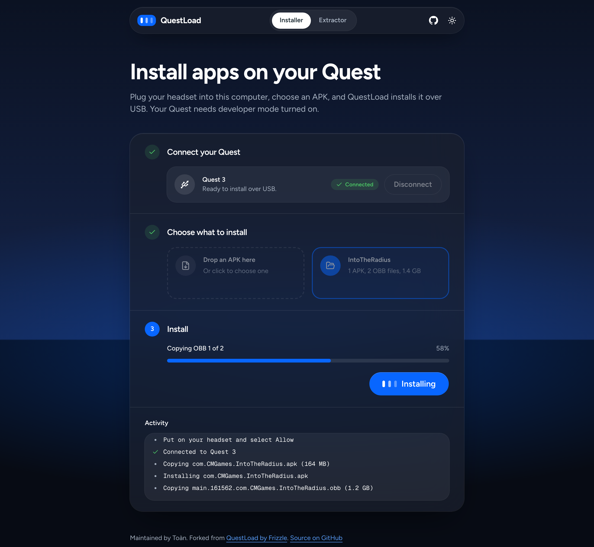

<div align="center">

# QuestLoad

**QuestLoad** is a browser‑based sideloader for Meta Quest headsets. It lets you install custom APKs on the Meta Quest directly from your web browser. Developer mode must be enabled on your headset.

This fork is maintained by Toàn. QuestLoad was created by [Frizzle](https://github.com/FrizzleM/QuestLoad).

<br/>
  <a href="https://frizzlem.github.io/QuestLoad/">
    
  </a>
  
  <a href="https://github.com/nerd-coder/QuestLoad/issues">
    
  </a>

</div>



## Requirements

- Meta Quest headset (2, 3, 3s, Pro)
- Developer mode enabled on your headset
- Browser with WebUSB support (Chrome, Edge, ect.)

## Quick Start

Follow these steps to sideload an app:

### 1. Launch QuestLoad
Open [frizzlem.github.io/QuestLoad](https://frizzlem.github.io/QuestLoad/).

### 2. Connect your Quest
Plug your Quest into the computer and click **Connect Quest**. Pick the headset in your browser's device list, then put on the headset and select **Allow** on the USB debugging prompt. QuestLoad shows the headset model once it's connected.

### 3. Choose what to install
Under **Choose what to install**, pick one. You can do this before or after connecting.
- **APK**: drop an `.apk` file on the **Drop an APK here** tile, or click the tile to choose one.
- **Bundle folder**: for games with OBB files, click **Choose a bundle folder** and select a folder with one APK at its top level and an OBB folder named after the package. QuestLoad checks the layout as soon as you pick it:

  ```text
  bundle/
  ├── com.CMGames.IntoTheRadius.apk
  └── com.CMGames.IntoTheRadius/
      ├── main.161562.com.CMGames.IntoTheRadius.obb
      └── patch.161562.com.CMGames.IntoTheRadius.obb
  ```

### 4. Install
Click **Install APK** or **Install bundle**. The progress bar and the **Activity** log show each step.

### 5. Launch the app on your Quest
After the install finishes, go to **Apps → Unknown Sources** on your headset and launch the app. When you're done, click **Disconnect** in QuestLoad.

## Future updates
- Ability to export games from the headset

## Remote games source config

QuestLoad now loads the game source from a local JSON config file at `apps/web/public/games-source.json`.

Update these values whenever you need:

```json
{
  "url": "https://example.com/api/games",
  "password": "replace-this-password"
}
```

The frontend sends the password in the `x-api-password` header when requesting the games URL.

## For offline usage

The web installer is built with **Vite + React**, using Bun, TanStack Query, and TanStack Store. To run it locally:

```bash
git clone https://github.com/nerd-coder/QuestLoad.git
cd QuestLoad
bun install
bun run dev
bun run build
bun run preview
```

`bun run dev:brand` serves the design system preview (`apps/brand`). The shared tokens and components live in `packages/ui`.

## Cloudflare Workers deployment

The app is deployed as Cloudflare Worker static assets by `.github/workflows/deploy.yml`.

Add `CLOUDFLARE_API_TOKEN` and `CLOUDFLARE_ACCOUNT_ID` as GitHub Actions secrets. Pushes to `main` build and deploy `apps/web/dist` with `apps/web/wrangler.jsonc`.
